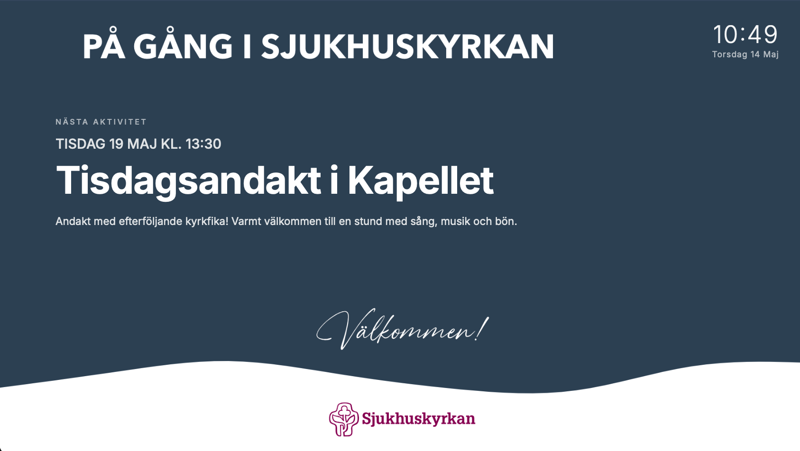

# Simple Calendar Display

A clean, modern, and lightweight digital calendar display designed for Raspberry Pi and single-board computers. It fetches events from a private iCal link and presents them in a beautiful, minimalist interface with a live clock. 

Now features a built-in Web GUI to easily customize text sizes and colors in real-time from any device on your network!

## Features
* Live iCal Sync: Automatically fetches and formats your upcoming calendar events.
* Digital Clock: Beautiful, minimalist real-time clock and date display.
* Web-based Settings: Change text sizes and colors on the fly via a dedicated web interface—no coding or CSS tweaking required.
* Responsive Design: Looks great on everything from small monitor hacks to dedicated wall tablets.

---

## Installation & Setup

### 1. Clone the repository
git clone https://github.com/sm7urw/simple-calendar-display.git
cd simple-calendar-display

### 2. Configure your Calendar Link
Create a file named .env in the project root folder and add your private iCal URL:
CALENDAR_URL="https://your-calendar-provider.com/private/link.ics"

### 3. Setup Virtual Environment & Dependencies
Create a Python virtual environment and install the required packages (including Flask and icalevents):
python3 -m venv venv
source venv/bin/activate
pip install Flask icalevents

### 4. Start the Application
To run the Flask server in the background so it stays alive after you close the terminal:
nohup ./venv/bin/python app.py > /dev/null 2>&1 &

---

## How to Access

Once the server is running, you can access the calendar and the configuration page from any browser on your local network:

* Calendar View: http://<your-pi-ip>:8080/
* Settings GUI: http://<your-pi-ip>:8080/settings

---

## Project Structure
* app.py – The Flask web server handling the routing and backend configuration.
* index.html – The core frontend displaying the clock and calendar events.
* config.json – Centralized storage for your customized text sizes and colors.
* templates/settings.html – The web interface featuring sliders and color pickers.

## License
This project is open-source and available under the MIT License.

---

  

  

